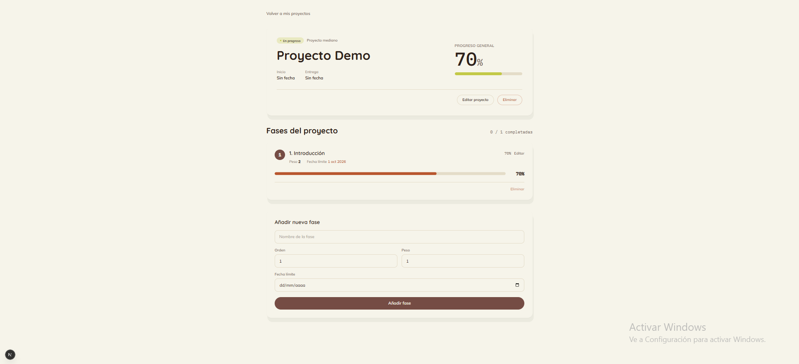
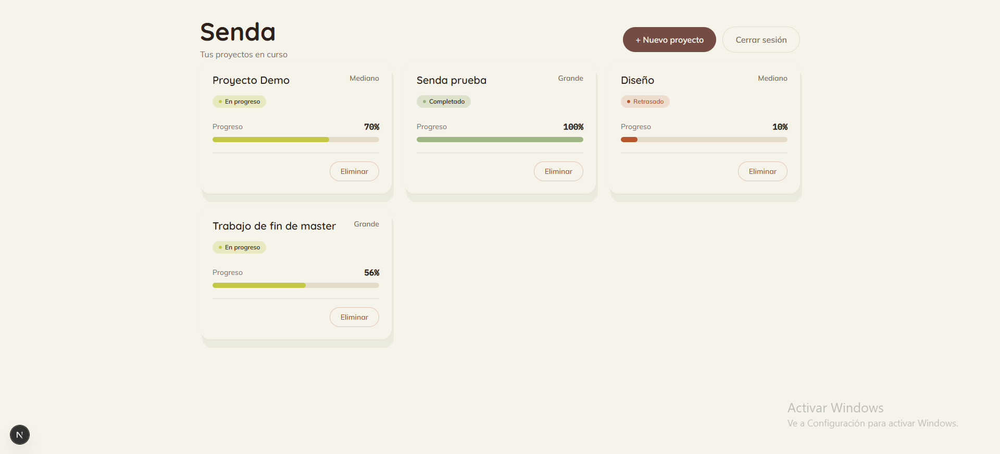

# 🌿 Senda — Organizador de proyectos académicos

Aplicación web fullstack para organizar proyectos del ámbito académico.
Cada proyecto se divide en fases y el avance se ve como un **sendero de hitos**:
el progreso general se calcula solo, ponderado por el peso de cada fase.

🔗 **Demo en producción:** [senda-chi.vercel.app](https://senda-chi.vercel.app)

## Probar la demo

Puedes entrar sin registrarte:

- **Usuario:** `demo`
- **Contraseña:** `Demo-Senda-2026`




---

## Qué hace

- Registro, login y logout con **JWT en cookie `httpOnly`**
- Rutas protegidas: sin sesión, redirección automática a `/login`
- CRUD de **proyectos** y de **fases** (crear, ver, editar y borrar)
- Control de progreso por fase, con **recálculo ponderado** del progreso general
- Estado automático del proyecto: `PLANNED` · `IN_PROGRESS` · `COMPLETED` · `DELAYED`
- Interfaz con identidad propia: paleta, tipografías y micro-animaciones de progreso

---

## Stack

**Frontend**
`Next.js` `React` `TypeScript` `Tailwind CSS v4` `Axios`

**Backend**
`Java 17` `Spring Boot` `Spring Security` `JWT` `Spring Data JPA` `Lombok` `BCrypt` `Maven`

**Base de datos**
`MySQL`

**Despliegue**
`Vercel` `Render` `Docker` `Aiven`

---

## Arquitectura

```
Navegador → Vercel (Next.js) → /api/* rewrite → Render (Spring Boot) → Aiven (MySQL)
```

El navegador solo habla con el dominio de Vercel. Las peticiones a `/api/*` se reenvían
al backend con `rewrites` de Next.js, así la cookie es de primera parte y no hace falta
abrir CORS con credenciales en producción.

**Decisiones que tomé**
- **Cookie `httpOnly` en vez de `localStorage`:** el token no es accesible desde JavaScript, lo que reduce el riesgo ante XSS.
- **Proxy con `rewrites` en vez de `SameSite=None`:** más simple y más seguro.
- **Rutas protegidas desde el servidor:** los Server Components leen la cookie y redirigen con `redirect()`.
- **Errores centralizados:** `GlobalExceptionHandler` devuelve 401 claros en lugar de un 500 genérico.

---

## Estructura del repositorio

```
senda/
├── BACKEND/    API REST (config, controller, dto, exception, mapper, model, repository, service)
└── FRONTEND/   Next.js (App Router), componentes y next.config.ts con los rewrites
```

---

## Ejecutar en local

**1. Base de datos:** crea una base de datos MySQL vacía (Hibernate crea las tablas al arrancar).

**2. Backend** (`http://localhost:8080`)

```bash
cd BACKEND
./mvnw spring-boot:run     # en Windows: .\mvnw spring-boot:run
```

Variables de entorno:

| Variable | Descripción |
|---|---|
| `DB_HOST` | Host de la base de datos |
| `DB_PORT` | Puerto de la base de datos |
| `DB_NAME` | Nombre de la base de datos |
| `DB_USER` | Usuario de la base de datos |
| `DB_PASSWORD` | Contraseña de la base de datos |
| `DB_SSL_MODE` | Modo SSL de la conexión (por ejemplo `REQUIRED` en Aiven) |
| `JWT_SECRET` | Clave secreta para firmar los tokens |
| `COOKIE_SECURE` | `true` en producción (HTTPS), `false` en local |
| `PORT` | Puerto del servidor (opcional, por defecto `8080`) |

**3. Frontend** (`http://localhost:3000`)

```bash
cd FRONTEND
npm install
npm run dev
```

Con un archivo `FRONTEND/.env.local`:

```env
BACKEND_URL=http://localhost:8080
```

---

## Próximos pasos

- [ ] Dashboard con estadísticas y filtro por estado
- [ ] Sidebar, calendario y gráficas
- [ ] Logo e identidad de marca
- [ ] Tests automatizados

---

## Dónde encontrarme

[](https://www.linkedin.com/in/aurora-avila-dev/)
[](https://github.com/auroraaviz)
[](mailto:auroraavilaizquierdo@gmail.com)

---

_Almería, España · Abierta a oportunidades🌱_
